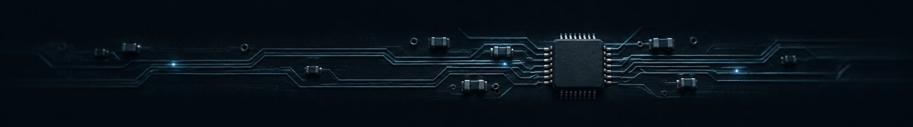

# Hi, I'm Abdulaziz — coderceo

## About Me

I'm a software engineer focused on full-stack JavaScript development with the MERN stack. I'm interested in system design and how web applications work from the UI down to the infrastructure.

## Current Focus

- Building full-stack web applications and learning more about the React ecosystem.
- Studying systems programming, system design, and the infrastructure behind web services.
- Practicing data structures and algorithms in JavaScript.
- Studying mathematics for machine learning and improving my English as part of SAT preparation.

## Technologies

View technology stack

- **Working with** `JavaScript` · `React` · `Node.js` · `Express` · `MongoDB`
- **Building foundations in** `C` · `C++`
- **Exploring** `Python` · `Java`

## Long-Term Goals

I'm working toward a senior engineering role and developing the skills to lead a team. Over time, I'd like to pursue machine learning engineering or principal-level work on large-scale systems. One goal is to contribute to products at a leading technology company.

## GitHub Activity

<picture>
  <source media="(prefers-color-scheme: dark)" srcset="https://streak-stats.demolab.com/?user=brolaziz&amp;hide_border=true&amp;disable_animations=true&amp;card_width=440&amp;card_height=170&amp;timezone=Asia%2FTashkent&amp;theme=github-dark-blue&amp;background=151B23&amp;stroke=30363D&amp;ring=58A6FF&amp;fire=58A6FF&amp;currStreakLabel=79C0FF">
  
</picture>

## Find Me Online

