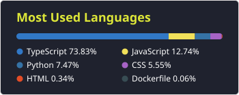

## Connect

  
  
  
  
  

Contact details

- **Handle** `coderceo`
- **Email** `dinocoder9@gmail.com`

---

### :man_technologist: About Me

I'm a software engineer focused on full-stack JavaScript development with the MERN stack.

- :telescope: I build full-stack web applications and deepen my knowledge of the React ecosystem.
- :seedling: I'm studying systems programming with C and C++, system design, and the infrastructure behind web services.
- :zap: I practice data structures and algorithms in JavaScript on [LeetCode](https://leetcode.com/u/coderceo/) and explore Python and Java.
- :books: I'm studying mathematics for machine learning and improving my English as part of SAT preparation.
- :dart: I'm working toward a senior engineering role and learning to lead a team. Long term, I'm interested in machine learning engineering or principal-level work on large-scale systems at a leading technology company.
- :mailbox: You can reach me on [LinkedIn](https://www.linkedin.com/in/coderceo/) or by [email](mailto:dinocoder9@gmail.com).

---

### :hammer_and_wrench: Languages and Tools

  &nbsp;
  &nbsp;
  &nbsp;
  &nbsp;
  &nbsp;
  &nbsp;
  &nbsp;
  

---

### :fire: My Stats

<!-- Enable the Blog Posts section when a blog RSS feed is available.

---

### :writing_hand: Blog Posts

-->
