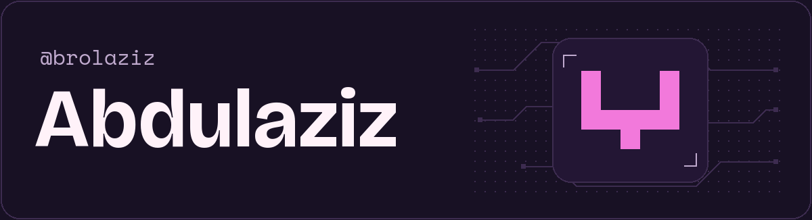

<a href="#loyihalar">
  <picture>
    <source media="(prefers-reduced-motion: reduce)" srcset="assets/banner.png">
    
  </picture>
</a>

## Salom, men Abdulaziz

Telegram botlar va veb-ilovalar yarataman. Algoritmlarni JavaScript’da mashq qilaman.

**JavaScript** · **TypeScript** · **Python**

## Loyihalar

<strong>Cafe Bot</strong> · Telegram Mini App

Mijozlar menyudan buyurtma beradi va uning holatini kuzatadi. Kafe xodimlari menyu va buyurtmalarni Telegram orqali boshqaradi.

[Kodni ko‘rish](https://github.com/brolaziz/cafe-bot) · [Mini App’ni ochish](https://cafe-bot-chi.vercel.app/)

<strong>CofeSave</strong> · Media yuklovchi bot

YouTube, Instagram va TikTok havolalaridan videolarni Telegramga yuklaydigan bot. Python, aiogram va FFmpeg bilan yozilgan.

[Kodni ko‘rish](https://github.com/brolaziz/cofeloader)

<strong>Luna</strong> · AI yordamchi

Qwen asosidagi Telegram yordamchisi. Guruh va shaxsiy chatlarda javob beradi, suhbat tarixini saqlaydi va guruh moderatsiyasini qo‘llab-quvvatlaydi.

[Kodni ko‘rish](https://github.com/brolaziz/luna)

<strong>LeetCode</strong> · JavaScript mashqlari

Two Sum, Palindrome Number va boshqa algoritmik masalalar uchun JavaScript yechimlarim.

[Yechimlarni ko‘rish](https://github.com/brolaziz/leetcode-javascript)

---

[Barcha repozitoriylar](https://github.com/brolaziz?tab=repositories)
